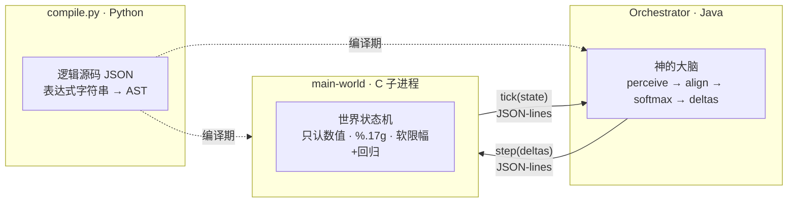

# 数据化神 · 跨语言严格管道推演引擎（Pantheon）

> 一个把「神」当作**数据**而非代码的推演系统：世界由 C 驱动，神由 Java 决策，逻辑由 Python 编译。
> 三层进程通过 **stdin/stdout + JSON-lines** 单向管道通信，契约先行，确定性可复现。

---

## 1. 它是什么

「数据化神」的核心思想：**神不是一堆 `if-else`，而是一组参数**——`goal`（目标）、`affinity`（亲和）、`power`（力量）、`temper`（脾性）。
系统每 tick 让诸神去「推动」一个共享世界（一组数值维度），世界按物理规则（软限幅 + 自然回归）回弹，
当某个神的「命途进度」走到尽头，它便重塑世界——或世界因维度越界而崩溃。

本仓库用**三种语言、严格管道**把它落地：

| 角色 | 语言 | 职责 |
|------|------|------|
| **世界状态机** | C (`src/c/world.c`) | 只认**数值** `dim / delta`，**不认识任何神名**；负责状态推进、软限幅、回归、崩溃检测 |
| **神的大脑** | Java (`src/java/world/`) | 每个神的感知、对齐度计算、softmax 决策；把逻辑 AST 跑成行为 |
| **编译器** | Python (`python/compile.py`) | 把 JSON 逻辑源码里的**表达式字符串**编译成 AST JSON（白名单防注入） |
| **逻辑源码** | JSON (`logic/`) | 行为用**表达式字符串**描述，不是代码——可配置、可扩展 |



数据流是**单向循环**的，每 tick 一次：`C 给状态 → Java 感知/决策 → Java 发 delta → C 推进世界 → C 回状态`。

---

## 2. 快速开始

### 依赖
- **C 编译器**：`gcc`（需链接数学库 `-lm`）
- **Java**：JDK 11+（`javac` / `java`）
- **Python**：3.11（`python3.11`，仅编译期用）

### 构建

```bash
make            # 编译全部：JSON→gcc(C)→javac(Java)，产物在 build/
```

构建链严格按依赖顺序（`Makefile` 注释）：
`JSON ─python compile─▶ build/logic/*.json ─┐`
`C 源码 ─gcc─▶ build/main-world              ├─▶ java -cp build/classes world.Orchestrator`
`Java 源码 ─javac─▶ build/classes/...         ┘`

> 用 `.stamp` 做增量：逻辑 JSON 未变更时跳过重新编译。

### 运行

```bash
# 单次推演（seed=42，最多 200 tick，输出 jsonl 回放）
make run ARGS="--seed 42 --max-ticks 200 --jsonl out.jsonl"

# 等价地直接跑 Java：
java -cp build/classes world.Orchestrator --seed 42 --max-ticks 200 --jsonl out.jsonl

# 批量多世界（并行 100 个 seed，输出终局分布）
make run ARGS="--seeds 100 --max-ticks 200"

# 无限运行（max-ticks=0 表示不限）
java -cp build/classes world.Orchestrator --seed 7 --max-ticks 0
```

### 命令行参数（Java `Orchestrator`）

| 参数 | 默认值 | 说明 |
|------|--------|------|
| `--seed` | `42` | 主种子；批量时 `masterSeed = seed*1000 + i` |
| `--seeds` | `1` | `>1` 时进入多世界并行模式，输出终局分布 |
| `--max-ticks` | `200` | 最大 tick 数；**`0` 表示无限运行** |
| `--jsonl <path>` | 无 | 逐 tick 写出 `{"t", "state", "modes", "progress"}`，供回放/绘图 |
| `--perturb <TICK:DIM:EPS>` | 无 | 在指定 tick 给某维度注入微小扰动（验证蝴蝶效应） |
| `--build <dir>` | `build` | 构建根目录 |
| `--logic <dir>` | `build/logic` | 编译后的逻辑目录 |
| `--exe <path>` | `build/main-world` | C 可执行文件路径 |
| `--silent` | 关 | 关闭每 100 tick 的进度打印 |

---

## 3. 契约与消息格式

C 与 Java 之间只有三种消息，定死后不变（JSON-lines，每行一个 JSON 对象）：

**① `init`** —— Java 启动 C 子进程后，先发世界规格：
```json
{"type":"init","dims":["order","entropy","life","knowledge","resources","stability"],
 "relax":0.02,"soft_lo":-0.3,"soft_hi":1.3,"hard_lo":-0.1,"hard_hi":1.1,"default_state":0.5}
```

**② `step`** —— Java 把一个 tick 内所有神的 delta 合并后发给 C：
```json
{"type":"step","deltas":{"entropy":0.13,"order":-0.04,"life":0.02}}
```

**③ `tick`** —— C 推进世界后回传新状态（带崩溃/退出信号）：
```json
{"type":"tick","t":37,"state":{"entropy":0.71,"order":0.42,"life":0.55,"knowledge":0.5,"resources":0.5,"stability":0.5}}
```
```json
{"type":"tick","t":156,"collapse":"dimension_overflow"}   // 维度越界崩溃
{"type":"tick","t":0,"collapse":"exit"}                    // C 收到 stop，干净退出
```

**④ `stop`** —— Java 结束时发送，C 退出。

> **精度约定**：C 输出 `double` 一律用 `%.17g`，保留微小变动的累积（维持蝴蝶效应可被观测）。

---

## 4. 逻辑源码格式

逻辑是**数据**，全部在 `logic/` 下，行为用**表达式字符串**描述。

### 世界 `logic/world.json`
```json
{
  "dims": ["order", "entropy", "life", "knowledge", "resources", "stability"],
  "relax": 0.02,        // 自然回归强度（向 default_state 回弹）
  "soft_lo": -0.3, "soft_hi": 1.3,   // 软边界：tanh 限幅区间
  "hard_lo": -0.1, "hard_hi": 1.1,   // 硬边界：越界即崩溃
  "default_state": 0.5
}
```

### 神 `logic/gods/destruction.json`（节选）
```json
{
  "name": "毁灭",
  "power": 1.0, "temper": 1.3,
  "goal":     {"entropy": 1.0, "order": 0.0, "life": 0.0},
  "affinity": {"entropy": 1.0, "order": 0.8, "life": 0.5},
  "state_init": {"rage": 0.0, "ema_align": 0.5, "progress": 0.0},
  "ema": {"alpha": 0.1},
  "perceive": {
    "rage":      "rage * 0.9 + abs(entropy - 0.5) * 0.1",
    "ema_align": "ema_align * (1 - alpha) + align * alpha",
    "progress":  "clamp(progress + 0.02 * temper * (align - 0.4), 0, 1)"
  },
  "modes": {
    "push":   {"score":"ema_align * 1.0 + 0.1",
               "deltas":{"entropy":"power * (1 + 2 * progress) * (goal_entropy - entropy) * aff_entropy * 0.2", ...}},
    "strike": {"score":"rage * 2.0 + temper * 0.1", "deltas":{...}},
    "adapt":  {"score":"temper * 0.15",              "deltas":{...}},
    "wait":   {"score":"0.05",                       "deltas":{}}
  }
}
```

每个神每 tick：**先 `perceive` 更新内部状态 → 再对每个 `mode` 算 `score` → softmax 采样一个 mode → 按所选 mode 的 `deltas` 推动世界**。

---

## 5. 表达式语言（DSL）参考

`compile.py` 把表达式字符串解析为 AST，`God.java` 在运行时解释执行。

**运算符**（优先级从低到高）：
`||` `&&` → `== != < <= > >=` → `+ -` → `* / %` → 一元 `-` `!` → 函数/括号。

**可用变量**（由 `God.context()` 注入，未定义变量会抛异常以保证确定性）：

| 类别 | 变量 | 含义 |
|------|------|------|
| 世界维度 | `order` `entropy` `life` `knowledge` `resources` `stability` | 当前世界状态（裸名） |
| 目标 | `goal_entropy` `goal_order` … | 该神对维度的目标值 |
| 亲和 | `aff_entropy` `aff_order` … | 该神对维度的影响权重 |
| 内部状态 | `rage` `ema_align` `progress` … | 来自 `state_init`，`perceive` 每 tick 更新 |
| 平滑参数 | `alpha` … | 来自 `ema` |
| 派生 | `align` 对齐度、`progress` 命途进度 | 由引擎计算 |
| 固有 | `power` `temper` `tick` | 神的力量/脾性/当前 tick |

**白名单函数**（仅这些可调用，且禁止成员访问——从结构上杜绝 `os.system` 之类注入）：
```
sin cos tan asin acos atan exp log log10 sqrt abs sign
floor ceil round min max pow clamp tanh mod hypot
```
> `clamp(x, lo, hi)`、`min(a,b)`、`max(a,b)`、`mod(a,b)` 等按名调用，参数逗号分隔。

---

## 6. 确定性保证

要让「同 seed 字节级一致」「扰动可复现」，系统做了三重锁：

1. **每神独立 `Random`**：`seed = masterSeed * 31 + name.hashCode()`，神与神之间互不影响，且同 seed 必复现。
2. **排序迭代**：神按 `name` 排序后用 `List` 遍历，绝不依赖 `HashMap` 的迭代顺序。
3. **恰好一次抽取**：每个神每 tick 在 softmax 采样时**只抽一次** `rng.nextDouble()`。
4. **精度**：C 端 `%.17g` 输出双精度；未定义变量即抛异常（不默认可变行为）。

---

## 7. 随时停止（三层兜底）

| 触发 | 机制 |
|------|------|
| 用户 `Ctrl-C` | JVM `shutdown hook` 置运行标志 → `EngineClient.stopAndWait()` 发 `stop` 并等 C 退出（2s 兜底 `destroyForcibly`） |
| C 收到 `SIGINT` | C 自身 handler 干净退出，管道 EOF，Java 感知后收尾 |
| 世界崩溃 | `dimension_overflow`（维度越界）或 `命途极致`（`progress ≥ 1.0`） |
| 自然终局 | `progress` 达到 1.0，世界被某神重塑 |

> 实测 `SIGINT` 后全局无 `main-world` 孤儿进程、无 Java 残留——无僵尸。

---

## 8. 验收标准与实测结果

设计稿定下 6 条「做到算成功」的标准，全部实测绘评：

| # | 验收标准 | 结果 | 证据 / 说明 |
|---|---------|------|------------|
| 1 | 加新神**不改代码** | ✅ 通过 | 新增 `logic/gods/equilibrium.json`（第 7 神「均衡」），`make` 自动纳入，运行出现 7 神，零代码改动 |
| 2 | 同 seed **字节级一致** | ✅ 通过 | `seed 42` 跑两次 `cmp` 完全一致（状态 + jsonl 均同） |
| 3 | 1e-6 扰动**分叉** | ⚠️ 机制通过 | 在 `tick 30` 注入 `1e-6` 后**精确从该 tick 分叉**（Δ=1.43e-6）；但被强阻尼吸收，宏观未翻转（见 §9） |
| 4 | `Ctrl-C` **无僵尸** | ✅ 通过 | `SIGINT` 后全局 `main-world` 孤儿 = 0、Java 残留 = 0 |
| 5 | `max-ticks 0` **无限跑** | ✅ 通过 | 循环条件 `maxTicks==0` 即无限；压测吞吐约 **650 万 tick/秒** |
| 6 | C 内 `grep` 不到神名（解耦） | ✅ 通过 | `grep -aiE '毁灭|存护|丰饶|智识|神秘|虚无|均衡' build/main-world` 无任何命中 |

---

## 9. 已知问题与后续方向

> 以下不影响管道架构正确性，属「先跑通再调参」阶段，如实记录：

1. **蝴蝶效应被强阻尼吸收（对应验收 #3）**
   当前世界是局部稳定的：`relax=0.02` + `tanh` 软限幅构成强回复力（负 Lyapunov 指数）。
   因此 `1e-6` 这种微观扰动会被迅速吸收，数值上确有精确分叉，但**宏观模式不翻转**。
   → 要看到蝴蝶效应宏观化：调低 `relax` 或施加临界量级的扰动。

2. **平衡性：某神总赢（设计稿预警的「bug」）**
   批量 60 seed 中约 59 次「神秘」命途极致。根因是当前神**独立行动**——
   尚未把第一阶段原型里的「克制矩阵 / faction 协同」移植进 JSON 逻辑，且早期维度容易溢出。
   → 后续用**纯表达式**即可表达神间交互（如某神的 `affinity`/`goal` 受其他神进度影响），解决此问题。

---

## 10. 调试纪律

- **JSON-lines 回放**：`--jsonl out.jsonl` 逐 tick 记录状态/模式/进度，可用 `python/plot.py` 画轨迹与分布。
- **扰动测试**：`--perturb 30:entropy:1e-6` 在 tick 30 给 `entropy` 注入 `1e-6`，验证分叉起点与衰减。
- **批量 seed**：`--seeds 100` 并行跑多世界，输出终局原因分布（`*.dist.json`），用于统计平衡性。

---

## 11. 扩展指南：加一个新神不改一行代码

1. 在 `logic/gods/` 下新建 `<名字>.json`，按 §4 格式写好 `goal / affinity / state_init / perceive / modes`（行为全用表达式）。
2. 运行 `make` —— `compile.py` 自动发现并编译新神，`manifest.json` 自动登记。
3. 运行 `java -cp build/classes world.Orchestrator ...`，新神即参与推演。

无需改动 C / Java / Python 任何源码。仓库内 `equilibrium.json`（「均衡」神，目标全 0.5）即是这种扩展的范例。

---

## 12. 目录结构

```
pantheon/
├── Makefile                 # 构建链（JSON→gcc→javac→run，.stamp 增量）
├── logic/                   # 逻辑源码（数据，不是代码）
│   ├── world.json           # 世界维度 / 边界 / relax / default
│   └── gods/                # 7 个神，行为全用表达式字符串
│       ├── destruction.json # 毁灭
│       ├── preservation.json# 存护
│       ├── abundance.json   # 丰饶
│       ├── erudition.json   # 智识
│       ├── mystery.json     # 神秘
│       ├── nihility.json    # 虚无
│       └── equilibrium.json # 均衡（扩展范例）
├── python/
│   └── compile.py           # 表达式→AST 编译 + 函数白名单校验
├── src/
│   ├── c/
│   │   ├── world.c          # 世界状态机（jsmn 解析 + 管道 + %.17g）
│   │   └── jsmn.h           # 单头 JSON 解析器（MIT）
│   └── java/world/          # 神的大脑 + 编排
│       ├── Orchestrator.java# 主循环 / 多世界并行 / 扰动测试
│       ├── God.java         # 神：独立 RNG / align / softmax 决策
│       ├── Expr.java        # AST 解释器
│       ├── EngineClient.java# C 子进程管理 / 管道 / 干净退出
│       ├── Json.java        # 自包含 JSON 解析（不依赖 Jackson）
│       └── WorldSpec.java   # 世界规格加载
└── build/                   # 编译产物（已 gitignore）
```

---

## 许可证

见仓库根目录 `LICENSE`。
